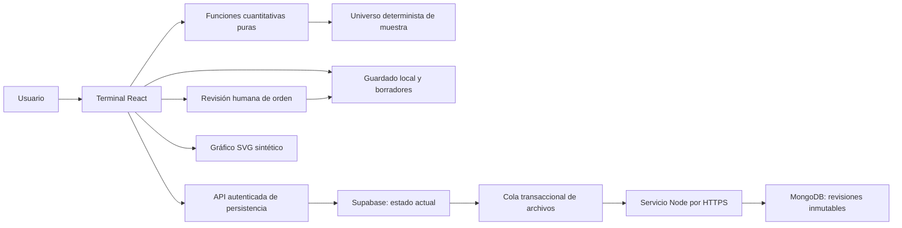

# Especificación del proyecto TEPIC

Ampliación de noviembre de 2026: ahora hay siete núcleos, comparación en vivo y sesiones sintéticas coherentes entre temporalidades. La descripción original de tres núcleos se amplía según [el detalle de cambios](../cambios/cambios-noviembre-2026.md); los cuatro adicionales son una propuesta de implementación, pendiente de confirmar si se esperan otros nombres académicos.

La solicitud del usuario define el alcance: construir desde cero una interfaz de bróker naranja, con rango operativo, histórico de velas, selección F0/F5 y generación de listas ordenadas de empresas. Los siete documentos de `guia-academica-inversiones` se consultaron como referencia posterior; sus instrucciones a alumnos y reglas de otro repositorio no se convierten automáticamente en instrucciones de este proyecto.

## Decisiones y procedencia

La guía describe DIANA y cinco cores de elegibilidad, dos generaciones de un monorepo, otros brókeres y un flujo OpenSpec existente. Ninguno de esos repositorios estaba presente en esta carpeta vacía. Se mantiene la selección explícita del usuario: F0 = BSM, griegas y equilibrio/probabilidad; F5 = Wheel, PMCC, Backspread 1:2 y Gamma Scalping.

Se toman de las guías los principios de trazabilidad, análisis determinista, separación entre sugerencia y ejecución humana, y confirmación de órdenes. Esta es una aplicación independiente de React 19/TypeScript/Vinext; no se declara una migración de DIANA ni cumplimiento de su constitución, su stack exacto o su CLI OpenSpec. No se importó código de las rutas mencionadas por las guías.

## Requisitos y criterios de aceptación

| ID | Requisito | Comportamiento verificable |
|---|---|---|
| R1 | Identidad visual | Interfaz oscura, navegación lateral, gráfico central, controles a la derecha y acentos naranja; adaptación móvil sin desbordamiento de página. |
| R2 | Rango operativo | Fechas ordenadas, horas 09:30–16:00 ET y apertura anterior a cierre. La orden conserva todo el rango elegido. |
| R3 | Histórico | Fechas ordenadas y final no posterior a inicio operativo; temporalidad y presets actualizan la serie sintética del gráfico. |
| R4 | Núcleos | Selección independiente de siete núcleos, indicadores en gráfica y comparación en vivo. Sin selección, no se crea lista y aparece error. Solo los activos participan en la media de puntuaciones. |
| R5 | Estrategias | Las cuatro estrategias solicitadas alteran los parámetros de clasificación. |
| R6 | Empresas potenciales | Generar crea una lista nueva en Mis listas; filas ordenadas por compatibilidad. Empates conservan liquidez y símbolo como desempate determinista. |
| R7 | Explicación | Cada puntuación abre los motivos y la configuración original, incluida su tasa anual. No se presenta como beneficio esperado. |
| R8 | Compra/venta call/put | Formulario validado, revisión del contrato y confirmación explícita de una simulación. Nunca se ejecuta en un bróker. |
| R9 | Persistencia | Listas, órdenes, ciclos y tasa sobreviven a la recarga. Sin configuración remota se conservan en el navegador; con Supabase se guardan por usuario y MongoDB archiva revisiones. Las listas guardadas recuperan sus filtros al abrirlas. |
| R10 | Consulta | Búsqueda, ordenación, exportación CSV, listas manuales, filtros de órdenes y eliminación local. |
| R11 | Instalación | Manifest e iconos para instalación; service worker de producción ofrece una página explícita sin conexión. No se afirma funcionalidad completa offline. |
| R12 | Histórico real | Adaptador Alpaca paginado, rangos 3A/5A diarios, fechas con año, fuente identificada, ajustes por splits, sesiones intradía por calendario y CSV original. Requiere claves y cobertura del proveedor. |
| R13 | Entrada y validación | Reglas causales SMA20/50 con RSI14, marcas sobre el gráfico y validación temporal del último 30%, costes y ejecución en la apertura siguiente. No se garantiza una predicción rentable. |
| R14 | Automatización | Servicio Node independiente de entradas de acciones Alpaca Paper, planes desactivados inicialmente, propietario autenticado, presupuestos y reservas duraderas contra duplicados. No envía las opciones F5 ni dinero real. |

## Arquitectura

El código se organiza por sección en `src/cores/`, `src/api/` y `src/features/`. Consulta [la estructura del proyecto](estructura-del-proyecto.md) para localizar cálculos, integraciones, pantallas y pruebas.

El Worker de Sites sirve la aplicación y autentica las consultas de persistencia, histórico y cuenta de práctica. El [diseño de base de datos](base-de-datos.md) describe Supabase, el archivo MongoDB, sus permisos y la importación local. La integración Alpaca y el servicio independiente de ejecución se explican en [su guía](../integraciones/alpaca-y-automatizacion.md). Los proyectos remotos y las claves aún requieren configuración; las pruebas locales no afirman una conexión externa inexistente. Las estrategias de opciones conservan su simulación educativa.

## Semántica del ranking

Cada estrategia configura objetivos de IV, delta, prima y plazo. Cada núcleo produce una puntuación parcial entre 0 y 1; se promedian únicamente los seleccionados y se escalan a 0–100. BSM aporta ajuste de prima, IV y plazo; griegas aportan delta/gamma, liquidez y plazo; probabilidad combina el cálculo de una pierna con liquidez e IV. La explicación muestra las magnitudes utilizadas.

No se calcula la probabilidad conjunta de una estrategia multipierna ni un retorno esperado. La cadena de opciones, volatilidad realizada e histórico real no están disponibles. El parámetro histórico sirve al gráfico demostrativo; no se utiliza como evidencia de backtesting.

## Validación y límites

Las pruebas cuantitativas cubren benchmark BSM, paridad con dividendos, griegas por diferencias finitas, vencimiento, volatilidad cero, equilibrio decimal, probabilidad y pesos/estrategias/plazos/tasa del ranking. La comprobación de navegador recorre la creación de listas, ordenación, búsqueda, errores, compra call, venta put, revisión, persistencia y diseño móvil.

Las limitaciones pendientes para un producto conectado son: datos y cadenas reales, calendario de sesiones/festivos/medias sesiones, vencimientos negociables, valoración y órdenes multipierna, gestión de márgenes, asignación anticipada, rebalanceo de Gamma Scalping y autenticación de bróker. La persistencia por usuario está implementada y probada localmente; la conexión con proyectos Supabase y Atlas reales queda pendiente de configuración. No se consideran verificadas operaciones con una cuenta real.
