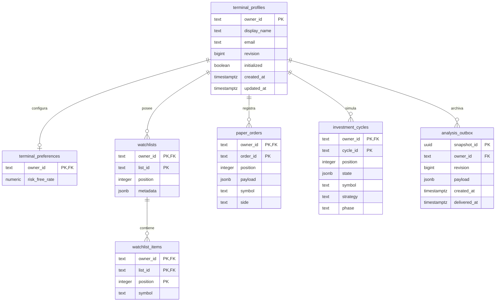
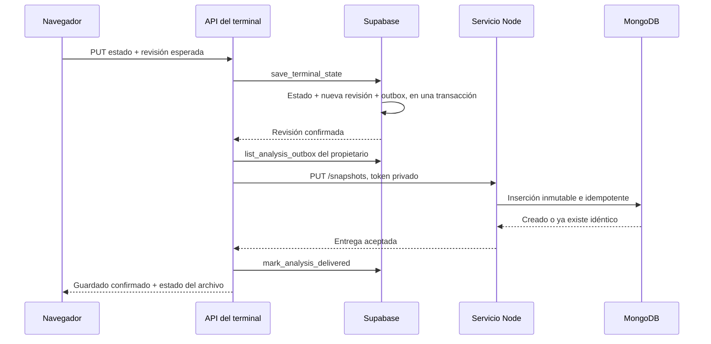

# Modelo y diseño de persistencia

El terminal conserva su estado vigente en **Supabase / PostgreSQL** y archiva versiones inmutables en **MongoDB**. El navegador consulta la API de la aplicación; las claves de ambos proveedores permanecen en los servidores. Sin configuración remota, la aplicación sigue guardando en el navegador.

La implementación usa los contratos del terminal en [`src/db/state.ts`](../../src/db/state.ts). Los cálculos BSM, las griegas, el ranking y la simulación de ciclos siguen en sus módulos actuales; la persistencia almacena sus entradas, registros y resultados sin cambiar las fórmulas.

## Responsabilidad de cada almacén

| Almacén | Responsabilidad |
|---|---|
| Supabase | Estado actual por usuario: preferencias, listas, órdenes simuladas y ciclos completos. También guarda la revisión y la cola de archivos pendientes. |
| MongoDB | Instantáneas históricas completas de revisiones confirmadas en Supabase. No participa en el cálculo del efectivo vigente ni en la confirmación del guardado principal. |
| Navegador | Datos locales anteriores a la conexión y borradores recuperables de cada cuenta. No sustituye al estado remoto cuando este está configurado. |

La primera versión archiva el estado completo: no genera un informe de rentabilidad ni una cotización real. Una revisión de MongoDB conserva exactamente los datos usados por el terminal en ese momento.

## Modelo relacional: siete tablas

`owner_id` es el identificador estable de la identidad de Sites, de tipo texto. El correo es un atributo de contacto; no es una clave. Una lista como `favorites` puede existir para varios usuarios porque la clave primaria incluye al propietario.

| Tabla | Decisión de diseño |
|---|---|
| `terminal_profiles` | Guarda la revisión de concurrencia. `initialized = false` distingue una cuenta aún sin datos de una cuenta que eliminó intencionalmente sus listas u órdenes. |
| `terminal_preferences` | La tasa libre de riesgo usa `numeric` y admite valores entre 0 y 0.25. |
| `watchlists` | `metadata` conserva nombre, estrategia, configuración y puntuaciones. El ID forma parte de la clave y los símbolos viven en la tabla relacionada. |
| `watchlist_items` | Conserva el orden de símbolos, impide repetir una empresa en la misma lista y usa una relación compuesta con la lista del mismo propietario. |
| `paper_orders` | El documento JSONB conserva el contrato de la orden simulada. Símbolo y lado se generan a partir del documento y se pueden consultar sin mantener copias independientes. Los números JSONB se almacenan como valores numéricos de PostgreSQL. |
| `investment_cycles` | Un ciclo es un agregado atómico: configuración, efectivo, acciones, piernas y eventos se guardan juntos en JSONB. Símbolo, estrategia y fase son columnas generadas para consultar e indexar. |
| `analysis_outbox` | Conserva la instantánea confirmada y su estado de entrega a MongoDB. La pareja `(owner_id, revision)` es única. |

Las listas, órdenes y ciclos tienen una posición explícita para reconstruir su orden original. Las relaciones con el perfil usan `ON DELETE CASCADE`. El borrado administrativo de una cuenta debe considerar también sus archivos históricos en MongoDB: esa eliminación externa no ocurre automáticamente por una clave foránea de PostgreSQL.

Los índices permiten buscar símbolos por propietario, filtrar ciclos por fase, consultar órdenes por fecha y localizar las revisiones aún pendientes de archivo. La migración contiene controles de estructura, tipos, límites, claves y unicidad. La API aplica además la validación completa del dominio antes de guardar.

## Identidad y acceso

La identidad procede de la petición autenticada de Sites. El cuerpo JSON del navegador no puede elegir el propietario. No se introduce un segundo sistema de login ni se necesita una relación con `auth.users` de Supabase.

Todas las tablas tienen RLS habilitado. Los roles `anon` y `authenticated` no tienen permisos sobre estas tablas ni sobre las funciones de persistencia; esta versión no consulta Supabase directamente desde el navegador. El servidor utiliza una clave secreta de Supabase y ejecuta cuatro funciones:

| Función | Resultado |
|---|---|
| `load_terminal_state(p_owner_id)` | `{revision, state, pendingArchives}`. Una cuenta nueva devuelve revisión 0 y estado `null`. |
| `save_terminal_state(p_owner_id, p_display_name, p_email, p_expected_revision, p_state)` | Guarda el estado y devuelve `{revision}`. |
| `list_analysis_outbox(p_owner_id, p_limit)` | Lista archivos pendientes del propietario, en orden de revisión. |
| `mark_analysis_delivered(p_owner_id, p_ids)` | Confirma únicamente los IDs que pertenecen al propietario indicado. |

Las funciones usan `SECURITY DEFINER` con `search_path` vacío y permisos de ejecución para `service_role`. La clave secreta representa al servidor, por lo que la autorización de cada usuario se comprueba en la API antes de invocar estas funciones. Consulta la [documentación oficial de claves](https://supabase.com/docs/guides/getting-started/api-keys) para distinguir claves públicas y secretas.

La API aplica límites de tamaño, valida los datos y exige el mismo origen en las escrituras. Sus respuestas privadas no se almacenan en cachés compartidas. La identidad simulada del servidor local solo sirve para desarrollo; el servidor de desarrollo no debe exponerse a otros usuarios.

## Guardado atómico y concurrencia

El navegador obtiene una revisión y envía esa revisión junto con su estado al guardar. Dentro de una transacción, PostgreSQL:

1. Bloquea el perfil del propietario para serializar sus escrituras.
2. Compara la revisión actual con la esperada.
3. Reemplaza las preferencias, listas, órdenes y ciclos de ese propietario.
4. Incrementa la revisión y crea una entrada inmutable de outbox.
5. Confirma todos los cambios juntos.

Una validación fallida revierte todos los cambios: ni las listas anteriores, ni el efectivo, ni la revisión quedan parcialmente modificados. Si otra pestaña guardó antes, la función devuelve `PT409` y la API responde HTTP 409. El cliente conserva el borrador y permite cargar el estado de la cuenta; no mezcla silenciosamente saldos y posiciones de sesiones distintas.

La lectura bloquea el perfil de forma compartida mientras reconstruye los agregados, evitando combinar una revisión anterior con filas de una escritura posterior.

## Protocolo de archivo hacia MongoDB

El outbox se escribe **en todos los guardados**, aunque MongoDB todavía esté deshabilitado. Las revisiones pendientes pueden enviarse cuando se configure el servicio. Un fallo del archivo mantiene la entrada pendiente y conserva el guardado principal ya confirmado.

Los accesos de lectura y guardado del terminal intentan entregar un lote acotado de pendientes del usuario actual. No existe en esta primera versión un trabajador programado que procese automáticamente a todos los usuarios mientras están desconectados. Si hubo un fallo después de insertar en MongoDB pero antes de confirmar en Supabase, el reintento envía la misma instantánea y obtiene el mismo resultado.

En MongoDB, `analysis_snapshots` conserva:

| Campo | Uso |
|---|---|
| `_id` | UUID de `analysis_outbox.snapshot_id`. |
| `ownerId` | Propietario original de la revisión. |
| `revision` | Número de versión en Supabase. |
| `schemaVersion` | Versión del formato; actualmente 1. |
| `state` | Listas, órdenes, ciclos y tasa de esa revisión. |
| `createdAt` | Fecha original del archivo, almacenada como fecha BSON. |

El índice único `(ownerId, revision)` y la inserción con `$setOnInsert` impiden reemplazar un histórico. Un reintento idéntico se acepta; un UUID o revisión con contenido distinto genera un conflicto.

El driver MongoDB se ejecuta en un **servicio Node separado**. El Worker de Sites utiliza HTTP/HTTPS para comunicarse con ese servicio; no abre una conexión MongoDB directa. En producción, el servicio debe tener una URL HTTPS y un token privado compartido con el servidor del terminal. El servicio también ofrece consulta de metadatos e instantáneas por propietario; estas rutas no se exponen directamente al navegador. Consulta su [contrato HTTP](../../services/mongo-api/README.md).

## Migración de datos locales y recuperación

La aplicación no importa automáticamente el almacenamiento antiguo a cualquier cuenta que inicie sesión. Cuando una cuenta remota aún no tiene datos, ofrece importar los datos de ese navegador o comenzar sin importar. Los borradores posteriores se separan por identidad y pueden descargarse.

Una recuperación desde MongoDB requiere una operación administrativa manual: obtener una instantánea del propietario correcto, validar su `state`, leer la revisión vigente y guardar ese estado como una revisión nueva. La revisión histórica no debe reemplazar el contador actual. No hay restauración automática desde MongoDB ni una pantalla de selección de históricos implementada.

## Límites y operación

- Hasta 200 listas, 5,000 órdenes y 200 ciclos por usuario, sujetos al límite total del estado.
- Nombres de lista e identificadores de registros de hasta 128 caracteres; hasta 1,000 símbolos distintos por lista.
- Órdenes de entre 1 y 100 contratos. La API valida fechas, números finitos y estructura de ciclos.
- Estado completo de hasta 2 MiB menos 8 KiB, con espacio reservado para el sobre del archivo. PostgreSQL aplica el límite sobre su texto JSONB canónico en UTF-8; también hay límites de cuerpo en la API y el servicio MongoDB.
- El almacenamiento histórico y el outbox no tienen eliminación automática. Es necesario definir retención, copias de seguridad y limpieza administrativa según el uso; con MongoDB deshabilitado seguirán acumulándose pendientes.
- La sincronización usa carga y guardado por revisión. No implementa colaboración simultánea, mezcla de cambios ni actualización en tiempo real entre dispositivos.

La [migración SQL](../../supabase/migrations/202611130001_terminal_persistence.sql) se aplica antes de conectar la aplicación. Las peticiones nunca crean tablas, colecciones ni índices. Las pruebas de PostgreSQL se ejecutan localmente con PGlite; las pruebas del bridge comprueban HTTP y el contrato con un repositorio de prueba. Esas comprobaciones no sustituyen una prueba contra tus proyectos reales de Supabase y Atlas.

Sigue la [guía de configuración](../base-de-datos/configuracion.md) para crear los proyectos y activar la integración.
