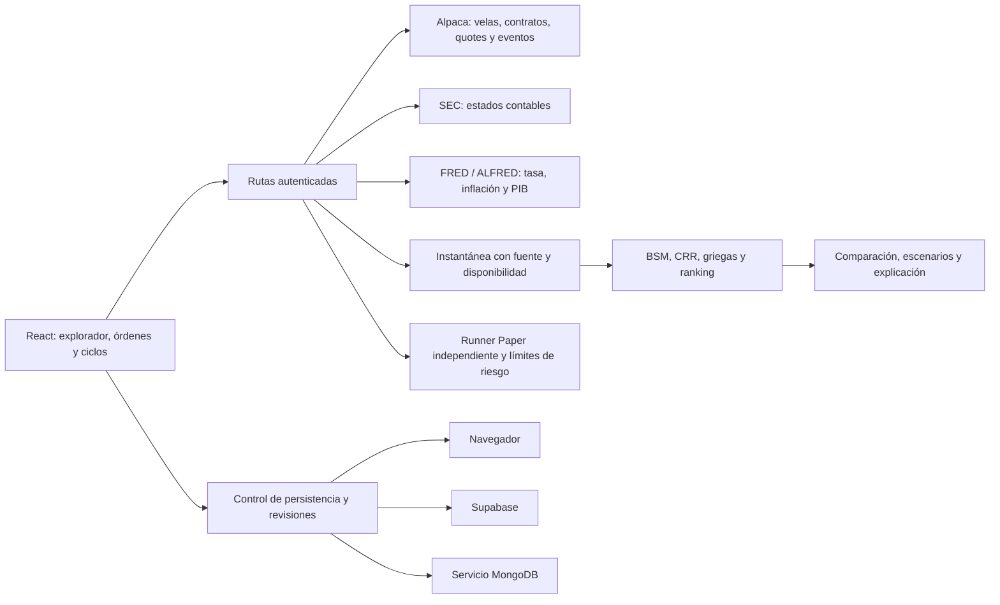

# Guía de explicación del proyecto

## Propósito y alcance

TEPIC Options Lab permite inspeccionar datos, comparar estructuras de opciones y
recorrer simulaciones. Cada resultado distingue fuente externa, cálculo, supuesto
y dato faltante. Una puntuación de compatibilidad no equivale a rendimiento esperado.
Las órdenes del laboratorio y los ciclos son distintos del servicio Alpaca Paper.

## Arquitectura y recorrido de datos

El servidor guarda credenciales y comprueba identidad y propietario. El cliente
recibe datos normalizados, nunca claves. Supabase y MongoDB conservan conjuntos
independientes; el selector no migra ni borra información. El runner vive fuera
de la pestaña, usa reservas idempotentes y distingue envío, ejecución y posición.

## Fórmulas y unidades

- **BSM:** precio europeo a partir de spot, strike, plazo, volatilidad, tasa y
  dividendo continuo. Tiempo en años de 365 días; volatilidad en decimal.
- **Griegas:** delta por cambio de precio; gamma como cambio de delta; theta por
  día; vega y rho por un punto porcentual. Las unidades se explican en el laboratorio.
- **CRR:** árbol binomial con ejercicio americano en nodos; los pasos se configuran
  y se comprueba convergencia. Las griegas BSM siguen siendo aproximaciones europeas.
- **IV:** Newton protegido con bisección y límites de precios. Recuperar la IV
  desde una prima generada por BSM demuestra consistencia numérica, no una IV nueva
  observada en mercado.
- **HV:** desviación muestral de retornos logarítmicos diarios, anualizada con
  raíz de 252. No se confunde con IV; usarla para una opción exige modo estimado.
- **Payoff:** cantidades firmadas, primas por multiplicador y acciones entregables.
  Se distinguen `multiplier` y `size`; una cesta o entrega desconocida no se trata
  como contrato estándar. Pérdidas y equilibrios se calculan por tramos cuando
  comparten vencimiento, sin inferir los extremos de cinco escenarios arbitrarios.

## Estrategias y decisiones

| Estrategia | Estructura analizada | Riesgo que debe explicarse |
|---|---|---|
| Wheel | Put con efectivo reservado; el ciclo posterior puede recibir acciones y vender call | La prima no elimina la caída de la acción. La call futura aún no tiene cotización al abrir la put. |
| PMCC | Call larga y call corta de vencimiento anterior | Débito, asignación, financiación y cambio de IV de la larga. Un débito pequeño no acredita margen suficiente. |
| Backspread | Una call inferior vendida y dos superiores compradas | Valle de pérdida entre strikes; prima neta y cantidades importan conjuntamente. |
| Gamma | Straddle y coberturas en acciones a través de una trayectoria | Realizada frente a implícita, theta, spread, frecuencia de ajuste, préstamo y capital. Un payoff estático no evalúa scalping. |

El ranking aplica pesos normalizados de los cores seleccionados. Un peso cero
excluye ese core; uno positivo con datos faltantes bloquea el total. El modo
estimado y las fuentes quedan en el registro. El validador histórico separa
entrenamiento y prueba y no utiliza salidas que se conocerían después de decidir.

## Demostración sugerida

1. Señalar DEMO en índices y mostrar una empresa con fuentes externas y fechas.
2. Mostrar un dato externo faltante y un supuesto explícito en tarjetas separadas.
3. Comparar una estrategia, sus piernas, capital y pérdidas. Cambiar comisión o IV
   en el escenario y explicar por qué cambia el resultado.
4. Revisar y confirmar una simulación individual, abrir Órdenes y recargar. Expandir
   «Fuentes y supuestos» para reproducir las entradas guardadas.
5. Recorrer una pérdida de Wheel, una asignación de PMCC, el valle de Backspread y
   coberturas Gamma con costes. No esconder un resultado negativo.
6. Importar el ejemplo de validación y señalar que es sintético y no permite promover
   pesos como evidencia real. Repetir con un dataset real solo cuando esté disponible.
7. Mostrar cuenta/estado Paper y distinguir fixtures de pruebas de interfaz de una
   consulta real y de una operación efectivamente enviada.

## Trazabilidad con requisitos

La auditoría `docs/mejoras-profesor/auditoria-rubricas-2026-11-17.md` se conserva
como documento histórico. `docs/verificacion/cierre-pendientes.md` detalla cambios,
pruebas y límites actuales. No se declara implementado Reg T/SPAN, un segundo
bróker, un motor Wasm/gRPC o una instalación humana en otra máquina por haber
aprobado pruebas de otros componentes.

Para preparar la entrega formal deben confirmarse integrantes, asignatura, docente,
fechas y formato final con la rúbrica original. Esta guía no inventa esos datos ni
sustituye la revisión del documento que el profesor utilice.

## Installation and validation note

The app separates observed inputs from explicit assumptions.
Historical validation requires point-in-time option chains and later exit quotes.
Synthetic examples verify the workflow, not investment performance.
Paper execution remains separate from local educational simulations.
