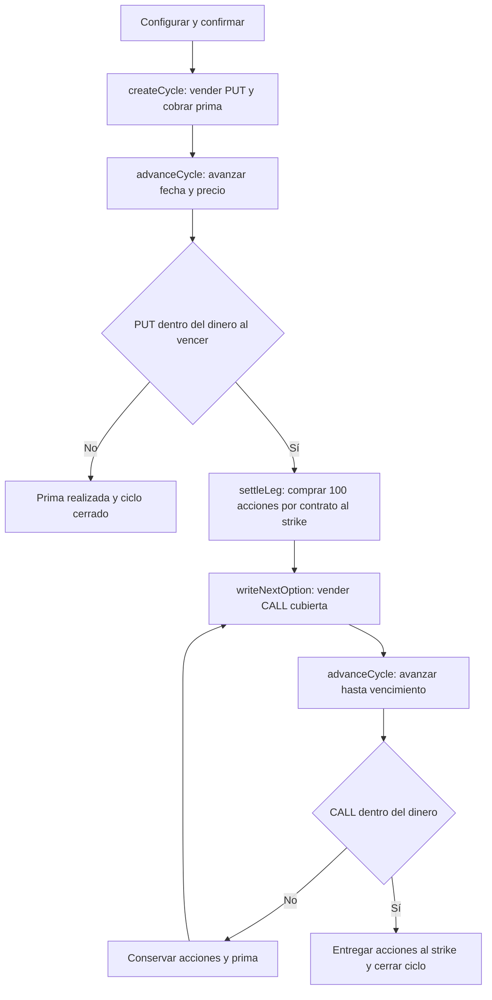

# The Wheel: recorrido del código, datos, fórmulas y exposición

Guía revisada contra el código del proyecto el 18 de noviembre de 2026.
Los precios del ejemplo son de demostración. La fecha fija permite reproducirlo.

## 1. Qué implementa este proyecto

Wheel combina dos etapas: vender una put con efectivo para comprar las acciones si
hay asignación y, después de recibirlas, vender una call cubierta. Si la call se
asigna, se entregan las acciones y se vuelve al efectivo. Si una opción vence sin
ejercicio, el recorrido toma otra rama.

Hay tres pantallas con alcances diferentes:

| Pantalla | Código principal | Qué hace |
|---|---|---|
| Ciclos de inversión | [cycle-lab.tsx](../../src/features/cycles/cycle-lab.tsx), [cycle-simulator.ts](../../src/features/cycles/cycle-simulator.ts) | Mantiene efectivo, acciones, opciones, fechas, asignaciones de práctica y resultado de la vuelta. |
| Operar → Simulación local | [order-ticket.tsx](../../src/features/orders/order-ticket.tsx) | Calcula una opción y guarda una intención individual. No crea automáticamente un ciclo ni procesa asignaciones. |
| Brókers · órdenes manuales → Alpaca Paper | [f5-panel.tsx](../../src/features/f5/f5-panel.tsx), [f5-service.ts](../../services/trading-runner/f5-service.ts) | Revisa y envía una put o call elegida, con contratos del proveedor y confirmación del usuario. Consulta ejecuciones y eventos del bróker. |

El selector Webull actual opera acciones; no implementa órdenes Wheel de opciones.

**Idea para explicarlo:** Wheel es la secuencia de decisiones. BSM valora las
opciones; las griegas describen sensibilidad; la contabilidad calcula el resultado.
El ranking selecciona candidatos mediante reglas heurísticas. Son tareas distintas.

## 2. Dónde empieza y de dónde salen las variables

En [terminal.tsx](../../src/features/terminal/terminal.tsx), buscar `sampleCompany`,
`orderInputs`, `<CycleLab` y `<OrderTicket`.

```tsx
// El laboratorio recibe la empresa del catálogo de muestra.
<CycleLab ... company={sampleCompany} initialStrategy={strategy} rate={rate}/>

// El ticket individual recibe investigación cuando se elige Alpaca.
<OrderTicket ... context={marketSource==='alpaca'?orderInputs:undefined} .../>
```

Son extractos abreviados para localizar el flujo; los puntos suspensivos no son
código para copiar y ejecutar.

### Entradas del laboratorio de ciclos

La función `defaultCycleConfig()` en `cycle-simulator.ts` usa el catálogo
[data.ts](../../src/features/market/data.ts), la estrategia y la tasa del terminal.
Después el usuario puede editar los campos del formulario.

| Símbolo | Variable en código | Origen en ciclos | Para qué se usa |
|---|---|---|---|
| S | `spot`, después `c.spot` | `company.price`; luego precio elegido al avanzar | Valor de acciones y cálculo BSM. |
| Kp | `shortStrike` | Strike inicial redondeado; editable | Put inicial y precio de compra al asignarse. |
| Kc | `longStrike` | Strike de la futura call; editable | Precio de venta de las acciones al asignarse la call. |
| D | `shortDays` | 32 días inicialmente | Plazo de la put y de cada call posterior. |
| σ | `iv` | `company.iv`; editable en porcentaje | Volatilidad anual de valoración, guardada en decimal. |
| r | `rate` | Tasa del terminal | Descuento y distribución neutral al riesgo. |
| q | `dividendYield` | `company.dividendYield` | Rendimiento continuo de dividendos en BSM. |
| p | `shortPremium` | Precarga BSM salvo excepción NVDA; editable | Prima por acción cobrada por la put. |
| c | `longPremium` | Precarga BSM salvo excepción NVDA; editable | Prima por acción de la futura call cubierta. |
| N | `contracts` | Usuario; inicialmente 1 | Cantidad de contratos. |
| M | Literal `100` | Convención del simulador | Acciones por contrato. |
| C0 | `capital` | Predeterminado; editable | Capital asignado al ciclo. |
| f | `feePerContract` | Usuario; inicialmente 0 | Comisión por contrato al abrir/cerrar opciones. |

En Wheel, `longStrike` y `longPremium` nombran los parámetros de la **call futura
vendida**; no indican que se compre una call. `longDays` no controla el plazo de esa
call: `writeNextOption()` vuelve a usar `shortDays`.

Para NVDA hay una excepción explícita en `defaultCycleConfig()`:

```ts
if(strategy==='wheel')
  Object.assign(config,{shortStrike:140,longStrike:145,shortPremium:4,longPremium:3});
```

Su precio de muestra es 147.22, IV 0.54 y dividendo 0.0003. Estos números no se
obtienen de una consulta actual. Cambiar el gráfico a Alpaca no convierte el ciclo
en un replay de mercado: el componente sigue recibiendo `sampleCompany`.
La tasa y el dividendo viajan en la configuración; el formulario de ciclos no
ofrece campos propios para editar esos dos valores. La tasa demo se cambia en
Configuración del laboratorio.

### Entradas externas del ticket y del análisis

El recorrido de investigación es:

```text
useCompanyResearch → API de investigación → fetchCompanyResearch
  ├─ deriveObservedMarket: velas cerradas → cierre, HV, retornos y volumen
  ├─ fetchAlpacaOptions: contratos + snapshots → K, fecha, bid, ask, IV
  ├─ fetchMarketContext: cotización de la acción y dividendos
  └─ fetchFredMacro: tasa DGS3MO / ALFRED
       ↓
completeOptionInputs → orderContext → OrderTicket → blackScholes / profitMetrics
```

Consultar [company.ts](../../src/api/research/company.ts),
[alpaca.ts](../../src/api/research/alpaca.ts),
[market-context.ts](../../src/api/research/market-context.ts),
[fred.ts](../../src/api/research/fred.ts),
[order-context.ts](../../src/features/orders/order-context.ts).

- **S:** último cierre diario válido; se sustituye por el punto medio `(bid+ask)/2`
  de la acción cuando llega una cotización válida.
- **K y vencimiento:** metadatos del contrato seleccionado. El ticket permite
  editarlos; esa edición constituye un escenario.
- **Prima:** punto medio del bid/ask como precarga del ticket. El análisis de
  estrategias usa bid para vender y ask para comprar, como estimación de entrada.
  El límite final lo elige el usuario; no acredita una ejecución.
- **IV:** publicada por el proveedor. Si falta y existen cotizaciones y entradas
  válidas, `completeOptionInputs()` intenta invertir el modelo; la identifica como
  IV calculada. No usa automáticamente HV como si fuera IV observada.
- **r:** `Math.log1p(DGS3MO / 100)`, una aproximación de tasa continua a partir de
  la serie de Treasury de tres meses. No se ajusta una curva distinta por plazo.
- **q:** `suma de dividendos ordinarios por acción de los últimos 365 días / S`,
  cuando el historial recibido supera las comprobaciones. Es una aproximación
  histórica del rendimiento futuro, no una promesa de pagos. También existen
  supuestos explícitos en la política de análisis.
- **T:** años hasta el vencimiento. En el ticket con investigación se usa `asOf`
  y el vencimiento a las 16:00 ET; sin investigación se usa la diferencia entre
  fecha inicial y vencimiento. El análisis de contratos tiene su propia función
  `valuationExpiry()`, con calendario/atributos cuando están disponibles.

Si faltan entradas, el ticket puede guardar una intención manual sin valoración;
no debe presentarse una griega o probabilidad ausente como calculada.

## 3. Precio teórico: Black–Scholes–Merton

Implementación: `blackScholes()` en [bsm.ts](../../src/cores/bsm.ts).

Con volatilidad positiva y tiempo positivo:

```text
T = D / 365
d1 = [ln(S/K) + (r − q + σ²/2)T] / (σ√T)
d2 = d1 − σ√T

Call = S e^(−qT) Φ(d1) − K e^(−rT) Φ(d2)
Put  = K e^(−rT) Φ(−d2) − S e^(−qT) Φ(−d1)
```

`Φ` es la distribución normal estándar acumulada. Se aproxima numéricamente en
`normalCdf()` de [math.ts](../../src/cores/math.ts); `Math.log` es logaritmo natural.
`σ=0.54` significa 54% anual, `r=0.04` significa 4% y `q=0.0003` significa 0.03%.
El resultado de BSM es por acción; el simulador lo multiplica por `100 × N`.

Con las entradas del script (S=147.22, K=140, D=32, σ=0.54, r=0.04,
q=0.0003), la put BSM vale aproximadamente **5.79228** por acción. Su delta es
−0.33862, gamma 0.01554, theta −0.12850/día y vega 0.15947 por punto porcentual.
La prima elegida de 4 es diferente del valor BSM: al abrir se cobran 400, pero
el pasivo vale 579.23; patrimonio inicial 19,820.77 y no realizado −179.23.

Extracto real de la fórmula:

```ts
const d1 = (Math.log(S / K) + (r - q + sigma * sigma / 2) * T) / (sigma * rootT);
const d2 = d1 - sigma * rootT;
const price = isCall
  ? Math.max(0, S * dq * normalCdf(d1) - K * dr * normalCdf(d2))
  : Math.max(0, K * dr * normalCdf(-d2) - S * dq * normalCdf(-d1));
```

Al llegar a D=0 se usa valor intrínseco: call `max(S−K,0)` y put `max(K−S,0)`.
Hay una rama específica para volatilidad cero. La validación está en
[validation.ts](../../src/cores/validation.ts).

**Dónde se utiliza:**

- Ciclo: `optionMark()` llama a BSM con el precio del escenario y días restantes;
  `cycleValue()` lo usa para patrimonio y delta. `closeCycle()` cierra a ese valor.
- Manual local: `model` en `OrderTicket` calcula precio y griegas; «Usar precio»
  copia el precio teórico al campo prima. Editar strike no reemplaza por sí solo la
  prima elegida.
- Investigación: `analyzeStrategy()` usa BSM para sensibilidades y CRR para precio
  inicial cuando el contrato está identificado como americano. No todo el proyecto
  usa exclusivamente BSM para valorar contratos americanos.

### Modelo americano e inversión de IV

En [binomial.ts](../../src/cores/binomial.ts), `binomialPrice()` implementa CRR:

```text
Δt=T/n; u=e^(σ√Δt); d=1/u
π=[e^((r−q)Δt)−d]/(u−d)
continuación=e^(−rΔt)[π V_subida+(1−π)V_bajada]
V_americano=max(valor intrínseco, continuación) en cada nodo
```

Esto considera la posibilidad matemática de ejercicio anticipado al valorar;
no decide qué hará un tenedor ni asigna posiciones del bróker.

El cálculo automático en
[complete-option-inputs.ts](../../src/api/research/complete-option-inputs.ts)
busca σ tal que `modelo(σ)=prima recibida`, con bisección, hasta 40 iteraciones,
tolerancia de precio `1e-5` y techo de IV 5. Usa CRR de 100 pasos para americanas o
BSM para europeas. El helper independiente
[implied-volatility.ts](../../src/cores/implied-volatility.ts) ofrece Newton
protegido con bisección para BSM; no es la función que usa este autocompletado.

## 4. Griegas: qué significan y cómo se calculan

Implementación: `calculateGreeks()` en [greeks.ts](../../src/cores/greeks.ts).
`φ(d1)=exp(−d1²/2)/√(2π)` es la densidad normal.

```text
Delta call = e^(−qT) Φ(d1)
Delta put  = e^(−qT) [Φ(d1)−1]
Gamma     = e^(−qT) φ(d1)/(Sσ√T)
Vega/1pp  = S e^(−qT) φ(d1)√T /100

A = −S e^(−qT) φ(d1)σ/(2√T)
Theta call/día = [A − rK e^(−rT)Φ(d2) + qS e^(−qT)Φ(d1)]/365
Theta put/día  = [A + rK e^(−rT)Φ(−d2) − qS e^(−qT)Φ(−d1)]/365

Rho call/1pp =  K T e^(−rT)Φ(d2)/100
Rho put/1pp  = −K T e^(−rT)Φ(−d2)/100
```

- Delta: cambio aproximado del valor de la opción al subir S un dólar.
- Gamma: cambio aproximado de delta al subir S un dólar.
- Theta: cambio por el paso de un día, manteniendo las demás entradas.
- Vega: cambio aproximado por subir IV un punto porcentual, por ejemplo 54%→55%.
- Rho: cambio aproximado por subir la tasa un punto porcentual.

BSM devuelve sensibilidades de una **opción comprada**, por acción. Para una put
vendida se cambia el signo y se multiplica por contratos y 100. La delta neta del
ciclo es:

```text
Delta neta = acciones + Σ(cantidad_firmada × 100 × delta_opción)
```

`cantidad_firmada` es negativa al vender. Por eso vender una put de delta negativa
produce una delta de posición positiva. El ticket muestra las griegas de la opción;
el panel del ciclo muestra la delta neta de toda la posición.

## 5. Equilibrio y probabilidad

Implementación del ticket: `profitMetrics()` en
[probability.ts](../../src/cores/probability.ts).

```text
Equilibrio put  = K − prima
Equilibrio call = K + prima

z = [ln(S/B) + (r−q−σ²/2)T] / (σ√T)
Probabilidad de beneficio de put vendida = Φ(z), con B=K−prima>0
```

Esto calcula `P(S_T>B)` bajo la distribución lognormal **neutral al riesgo**.
Excluye comisiones, financiación de prima y ejercicio anticipado. El helper maneja
por separado vencimiento, volatilidad cero, prima cero y equilibrio no positivo.
Para el ejemplo put 140/prima 4, el equilibrio sin costes es 136.
Con las entradas anteriores, el helper devuelve aproximadamente 66.92% para
esa put vendida; es una salida del modelo del ejemplo, no una frecuencia de éxito
observada ni una probabilidad calculada para toda la vuelta.

El ciclo no consulta esa probabilidad para decidir una asignación: aplica una
regla al precio elegido y al vencimiento. El análisis observado de Wheel calcula
el payoff de la put con bid y comisión de entrada en `analyzeStrategy()`; puede
mostrar un equilibrio diferente del ticket si sus primas/costes difieren. Ninguna
de esas probabilidades corresponde a la call futura ni a la vuelta completa.

## 6. Ciclo completo, función por función

Motor: [cycle-simulator.ts](../../src/features/cycles/cycle-simulator.ts).
La interfaz llama a sus funciones desde
[cycle-lab.tsx](../../src/features/cycles/cycle-lab.tsx).



### Apertura: `createCycle()` → `openLeg()`

Valida configuración y exige:

```text
capital mínimo del ejercicio = Kp × 100 × N + f × N
```

Es una validación de respaldo con el capital del ciclo. No resta el nominal de la
put del campo efectivo al abrir; el capital completo del ciclo sí queda
comprometido en `accountSummary()` para impedir asignarlo a otros ciclos.

```ts
if(c.strategy==='wheel')
  openLeg(c,{type:'put',quantity:-q,strike:config.shortStrike,premium:config.shortPremium,expiry});
```

Aquí `q` es la cantidad de contratos local a `createCycle`; no es el rendimiento
de dividendos de la notación BSM.

La convención firmada hace que vender cobre y comprar pague:

```ts
c.cash=round(c.cash-leg.quantity*100*leg.premium);
```

Si `quantity=-1` y prima=4: `cash = 20000 − (−1×100×4) = 20400`, antes de comisión.
Una prima cobrada no es automáticamente ganancia neta: sigue existiendo la
obligación de la opción vendida.

### Valoración: `optionMark()` → `cycleValue()`

```text
valorOpciones = Σ(cantidad_firmada × 100 × precioBSM)
patrimonio = efectivo + acciones × S + valorOpciones
resultadoTotal = patrimonio − capitalInicialDelCiclo
realizado = realizedOptions + realizedShares − comisiones
noRealizado = Σ(cantidad_firmada × 100 × (precioBSM−primaEntrada))
             + acciones × (S−stockBasis)
retornoPorcentual = resultadoTotal / capitalInicialDelCiclo × 100
```

El valor de una opción vendida aparece negativo porque es un pasivo. La prima
manual puede diferir del valor BSM; por eso el no realizado inicial puede ser
distinto de cero. El efectivo cobrado y el patrimonio no son la misma cantidad.

### Paso del tiempo: `advanceCycle()` → `expiryBoundary()`

El usuario proporciona nueva fecha y precio. El motor clona el estado y procesa
vencimientos atravesados. Si se salta un vencimiento, interpola linealmente el
precio entre el punto inicial y el final: no consulta un histórico intermedio.

`inTheMoney()` considera ejercitable una opción cuando su valor intrínseco es de
al menos $0.01, con tolerancia numérica. La asignación anticipada requiere pulsar
«Forzar asignación de práctica» y llama a `assignShortOption()`.

### Asignación: `settleLeg()` → `tradeShares()`

Quita la opción y contabiliza la prima como realizada. La cantidad de acciones es:

```ts
const shares=leg.quantity*100*(leg.type==='call'?1:-1);
tradeShares(c,shares,leg.strike,false);
```

- Put vendida: `−1×100×(−1)=+100`: comprar 100 acciones al strike.
- Call vendida: `−1×100×1=−100`: entregar 100 acciones al strike.

`tradeShares()` cambia efectivo, acciones, coste medio `stockBasis` y ganancia
realizada de acciones. La asignación usa `false`: no cobra comisión por acción
en esa transferencia en esta implementación.

### Call cubierta: `writeNextOption()`

Solo la permite con fase `shares` y al menos `100×N` acciones. Usa `longStrike`,
`longPremium` y un nuevo vencimiento `fechaActual + shortDays`; cobra otra prima.
La prima de esta call procede de la configuración inicial del ejercicio, incluso
al renovar; no se consulta su cotización futura ni se recalibra automáticamente.

Si vence sin ejercicio, vuelve a `shares` y se puede vender otra call. Si se
asigna, entrega las acciones y `finish()` marca `closed`. Una nueva vuelta de
puts requiere iniciar/repetir un ciclo.

### Cierre anticipado y trayectoria completa

- `closeCycle()`: recompra opciones vendidas a BSM, liquida acciones al precio
  del escenario, descuenta comisiones configuradas y termina sin exposición.
- `runScenario()`: ejecuta una trayectoria determinista de muestra. En Wheel,
  «Baja y recuperación» usa `Kp×0.93` en la primera etapa y `Kc×1.05` en la segunda.
  Al terminar liquida cualquier posición restante. No es una simulación Monte Carlo
  ni una predicción. El escenario de caída puede terminar con pérdidas.
- `record()`: guarda efectivo, acciones, patrimonio y resultado de cada evento.
  La interfaz muestra posiciones, historial, gráfico y exportación CSV.

Los eventos se guardan también durante transiciones internas; un evento aislado
puede anteceder al cierre/registro de los siguientes pasos de esa misma acción.
Para explicar los hitos consolidados, usar los estados devueltos por las funciones.

## 7. Ejemplo numérico comprobable

Capital $20,000; un contrato; put K=140/prima=4; call K=145/prima=3;
32 días por etapa, sin comisiones.

| Paso | Operación | Efectivo | Acciones | Resultado |
|---|---|---:|---:|---|
| Inicio | Capital del ciclo | 20,000 | 0 | 0 antes de abrir |
| Venta de put | Cobrar 100×4 | 20,400 | 0 | Descontar pasivo BSM para obtener patrimonio. |
| Put asignada con S=130 | Comprar 100×140 | 6,400 | 100 | Patrimonio 19,400; resultado −600. |
| Venta de call | Cobrar 100×3 | 6,700 | 100 | Todavía hay acciones y un pasivo por la call. |
| Call asignada con S=150 | Entregar 100×145 | 21,200 | 0 | Resultado final +1,200. |

```text
Ganancia final = 100 × [(145−140) + 4 + 3] = 1,200
Retorno sobre el capital asignado = 1,200/20,000 = 6%
```

Las fórmulas de resultado que explican ambos tramos, con un contrato estándar y
generalizadas a N contratos, son:

```text
Put al vencer = 100N × [p − max(Kp−S_T,0)] − costes

Si se asignó la put y luego se vendió una call sobre todas las acciones:
Resultado acumulado al vencimiento de la call
  = 100N × [S_T−Kp+p+c−max(S_T−Kc,0)] − costes
  = 100N × [min(S_T,Kc)−Kp+p+c] − costes
```

La segunda expresión supone una sola call posterior, mismas cantidades, sin
dividendos ni otras operaciones. Si las acciones siguen abiertas, expresa el
resultado total valorado al precio final, no solo lo ya realizado. Para el ejemplo
sin costes: equilibrio acumulado 133 cuando S_T está por debajo del strike de la
call; ganancia máxima 1,200 al alcanzar/superar 145; pérdida 13,300 si la acción
acabara en cero tras cobrar ambas primas. La put inicial por sí sola tiene pérdida
máxima 13,600. Son límites algebraicos; el formulario del simulador exige precios
estrictamente positivos y no permite introducir cero como siguiente precio.

Ese 6% corresponde a esta trayectoria de 64 días y capital asignado; no es tasa
anual ni rendimiento garantizado. Las acciones se venden a 145 aunque el escenario
marque 150: la call limita la ganancia por encima de su strike.

Otros desenlaces verificados por las pruebas del proyecto:

- Put vence con S=160: no se compran acciones y se gana $400, sin costes.
- Put asignada y posterior cierre de acciones a S=100: `400+(100−140)×100=−3600`.
- Vuelta completa con $0.65 de comisión por cada apertura de contrato: $1,198.70.
- Call vence con S=135: siguen las 100 acciones; puede venderse otra call.

La base contable de las acciones permanece en 140. El equilibrio económico tras
cobrar la put es 136 sin costes; no se debe confundir con `stockBasis`.

Ejecutar desde la raíz:

```sh
node scripts/explain-wheel.ts
```

El [script](../../scripts/explain-wheel.ts) importa las funciones del motor real,
muestra BSM y griegas con todas sus entradas, y recorre los cuatro hitos. No
requiere claves ni llama a servicios externos. Las pruebas existentes están en
[cycle-simulator.test.ts](../../tests/cycles/cycle-simulator.test.ts).

## 8. Cómo se presenta en manual

### Simulación individual

En `OrderTicket`, `side` empieza como `buy`. Para representar la primera etapa
Wheel hay que elegir **Vender + PUT**. Que Wheel esté seleccionada en el explorador
no convierte automáticamente el ticket en venta de put. En demo el tipo inicial
también es call; con investigación toma el tipo del contrato seleccionado.

El formulario calcula:

```ts
const total = Number(quantity) * multiplier * Number(premium);
```

Ese total es el crédito/débito de primas; no es el capital necesario para soportar
la asignación. Revisa fecha, horario, strike, contratos y prima; después guarda una
`PaperOrder` con estado `Simulada`, parámetros y procedencia. La devolución de
`onSubmit` en `terminal.tsx` añade el registro a `orders`; no llama `createCycle()`.
Guardar por separado una put y una call no incorpora automáticamente las acciones
de una asignación entre ambas.

El ticket conserva `multiplier` y `shares` del contrato cuando se verifican. Si
difieren, usa `K_efectivo=K×multiplier/shares` y convierte prima/valor para BSM.
El laboratorio de ciclos, en cambio, usa siempre 100 como convención de práctica.

### Alpaca Paper manual

`F5Panel` permite elegir Wheel y fase `put` o `call`, vencimiento, contrato, cantidad,
precio límite y presupuesto. `prepareOpening()` envía una solicitud de revisión;
`submit()` confirma la revisión identificada por `previewId`.

El servidor en `prepare()` de `f5-service.ts` verifica cuenta, posiciones,
cotizaciones, órdenes pendientes y límites. Para Wheel:

```text
Reserva para put = strike × contratos × 100
Acciones libres para call >= contratos × 100
```

Descuenta de las acciones disponibles las reservadas para otros planes y las ya
asignadas a cobertura. `openingLegs()` en
[validation.ts](../../src/features/f5/validation.ts) crea una pierna `sell_to_open`.
El precio límite de una venta es positivo; el lado `sell` expresa el crédito.

La revisión vence a los 60 segundos y se valida de nuevo antes del envío. La
habilitación en pantalla y servidor controla el envío; el motor usa identificador
de cliente, reserva persistida y conciliación para evitar duplicados.

La asignación no se deduce de que `S<K`. `f5Residual()` en
[f5-model.ts](../../services/trading-runner/f5-model.ts) concilia cantidades
ejecutadas, posiciones y actividades `OPASN`, `OPEXP`, `OPEXC`. Las cantidades y
estados deben venir del bróker. En este recorrido manual el usuario selecciona y
confirma cada etapa; el botón «Completar escenario» pertenece al laboratorio.

## 9. Los siete cores y su relación con Wheel

Se presentan en el explorador/comparador; no son siete fases del ciclo ni siete
sumandos del beneficio. El motor del ciclo llama a BSM y usa su delta, pero no
consulta el ranking para decidir asignaciones o seleccionar el precio siguiente.

La versión demo está en [ranking.ts](../../src/cores/ranking.ts). Para Wheel fija
como criterios de ejemplo: strike `0.94×S`, IV objetivo 31%, plazo 35 días,
delta absoluta objetivo 0.28 y rendimiento de prima objetivo 1.7%. Esos valores
son reglas de muestra del ranking; **no son** los parámetros especiales NVDA del
laboratorio ni parámetros que se desprendan de la fórmula BSM.

Para reproducir sus puntuaciones, definir:

```text
prox(x,a,t)=exp(−abs(x−a)/t); clamp(x)=max(0,min(1,x))
I=prox(IV,0.31,0.20); U=prox(D,35,52.5)
L=clamp(liquidezDemo/100)
Y=prox(precioBSM/S,0.017√(D/35),0.06)
A=prox(abs(delta),0.28,0.30)
P=probabilidad de beneficio de la put vendida con prima BSM
```

| Core demo para Wheel | Puntuación antes de convertir a 0–100 | Archivo |
|---|---|---|
| BSM | `0.46Y+0.34I+0.20U` | `bsm.ts` |
| Griegas | `0.48A+0.38L+0.14U` | `greeks.ts` |
| Probabilidad | `0.50P+0.30L+0.20I` | `probability.ts` |
| Volatilidad | `0.80I+0.20U` | `volatility.ts` |
| Tendencia | `0.80prox(cambioDemo,1,2.5)+0.20U` | `trend.ts` |
| Liquidez | `0.65L+0.25clamp(volumenDemo/250000)+0.10U` | `liquidity.ts` |
| Riesgo | `0.60/(1+4IV√(D/365))+0.25L+0.15U` | `risk.ts` |

La media de los cores seleccionados se limita a 0–1, multiplica por 100 y redondea.
Los pesos son decisiones del proyecto, no constantes de BSM ni probabilidades.

La versión con investigación está en
[observed-ranking.ts](../../src/cores/observed-ranking.ts). Usa contratos elegibles
y `analyzeStrategy()`; para Wheel solo evalúa la put inicial. Sus reglas cambian:

| Core observado para Wheel | Regla |
|---|---|
| BSM | Cercanía entre débito teórico firmado y entrada con bid/ask; escala `max(1,abs(débito),capitalRequerido)`. Si IV se calibró a esas mismas cotizaciones o hay primas supuestas, puntuación neutral 50 para no confundir coincidencia con ventaja. |
| Griegas | `1/(1+abs(deltaNeta)×S/max(1,capitalRequerido))`. |
| Probabilidad | Distribución neutral al riesgo sobre el payoff de la put, con costes de entrada. |
| Volatilidad | `IV/(IV+HV)` si hay ambas; sin IV, `1/(1+HV)`. |
| Tendencia | `trendBase + coef20×momentum20 + coef60×momentum60`. |
| Liquidez | Menor `clamp(1−(ask−bid)/primaMedia)` de las piernas; si no hay opciones, proxy de volumen monetario de la acción. |
| Riesgo | Perfil de drawdown y volatilidad bajista, limitado también por `clamp(1−pérdidaMáxima/capital)` cuando se conocen pérdida y capital. |

Cada componente se limita a 0–1 y redondea a 0–100. El total es la media ponderada
de los cores seleccionados con peso positivo; si falta alguno de ellos, queda sin
puntuación total. Los pesos/coeficientes están en
[evaluation-policy.ts](../../src/cores/evaluation-policy.ts).

Las métricas históricas se calculan en
[derive.ts](../../src/features/research/derive.ts):

```text
retornoLog_t = ln(cierre_t/cierre_(t−1))
HV = desviación muestral de hasta 252 retornosLog × √252
momentum_n = cierreActual/cierreDeHace_n_sesiones − 1
volumenMonetario20 = promedio(volumen×cierre) de últimas 20 sesiones
drawdownMáximo = max(1−cierre/máximoAcumulado), hasta 252 sesiones
volatilidadBajista = √promedio(min(0,retornoLog)²) × √252
```

HV usa sesiones bursátiles (252), mientras BSM mide tiempo con días calendario
(365). Son convenciones de dos cálculos diferentes.

## 10. Orden sugerido para explicar al profesor

1. Abrir `terminal.tsx`: señalar la entrada a ciclos, ticket y bróker.
2. Abrir `data.ts` y `defaultCycleConfig()`: identificar datos demo y parámetros.
3. Abrir `bsm.ts`: explicar entradas, d1/d2, Φ y precio por acción.
4. Abrir `greeks.ts` y `probability.ts`: distinguir sensibilidad, equilibrio y
   probabilidad de la put de cualquier resultado del ciclo completo.
5. Recorrer `createCycle → advanceCycle → settleLeg → writeNextOption → finish`.
6. Ejecutar `node scripts/explain-wheel.ts` y seguir efectivo y acciones.
7. En pantalla repetir: Ciclos de inversión → Wheel/NVDA → fecha 2026-11-09 →
   capital 20000 → put 140/4 → call 145/3 → 32 días → confirmar → fecha
   2026-12-11/precio 130 → avanzar → vender call cubierta → fecha
   2027-01-12/precio 150 → avanzar. Las comisiones deben estar en cero; para que
   también coincidan las valoraciones intermedias, usar tasa demo 4% en Configuración.
8. Abrir `order-ticket.tsx`: enseñar dónde aparecen precio, griegas y equilibrio,
   y que guardar esa operación no ejecuta el motor del ciclo.
9. Si se explica Alpaca, mostrar su revisión/validación y conciliación en código;
   no hace falta enviar órdenes para demostrar cómo está implementado.

Frase de exposición:

> Mi implementación separa la estrategia, la valoración y el registro de dinero.
> Wheel comienza vendiendo una put respaldada por efectivo. Si el ejercicio simula
> una asignación, compra las acciones al strike y habilita una call cubierta.
> BSM valora las posiciones abiertas, las griegas describen su sensibilidad y la
> contabilidad suma primas, compra y venta de acciones y comisiones. En la vuelta
> del ejemplo termina con 1,200 dólares de ganancia; otra trayectoria puede perder.
> Los ciclos usan precios elegidos. Las operaciones manuales del bróker dependen
> de sus ejecuciones y eventos confirmados.

## 11. Límites concretos de la implementación

- BSM del ciclo y ticket supone ejercicio europeo. La regla educativa de
  asignación del ciclo se aplica aparte; BSM no predice asignaciones.
- El ciclo mantiene IV, tasa y rendimiento de dividendos constantes; no abona
  dividendos en efectivo ni intereses del saldo, y no modela spread/deslizamiento.
- No calcula margen oficial de un bróker; las reservas son reglas del proyecto.
- Las trayectorias de muestra son deterministas y no prueban rentabilidad real.
- Una probabilidad neutral al riesgo y una puntuación de compatibilidad tienen
  significados distintos; ninguna garantiza el éxito del ciclo futuro.
- Este recorrido verificó el código y el ejemplo local, sin comprobar una
  conexión externa ni enviar órdenes.

Referencias conceptuales primarias: [OIC: put respaldada por efectivo](https://www.optionseducation.org/strategies/all-strategies/cash-secured-put),
[OIC: call cubierta](https://www.optionseducation.org/strategies/all-strategies/covered-call-buy-write)
y [OIC: entradas y alcance de Black–Scholes](https://www.optionseducation.org/advancedconcepts/black-scholes-formula).
Estas fuentes explican los conceptos; las reglas y cifras de esta guía proceden
del código del repositorio.
