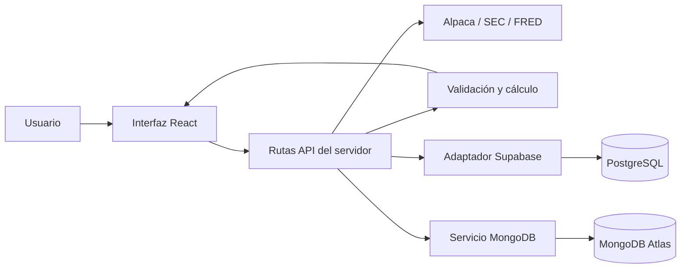

# Guion de demostración — TEPIC Options Lab

Presentación: 18 de noviembre de 2026, 15:00, horario acordado con el profesor.
Este recorrido es modular; ajustar duración cuando el equipo confirme el tiempo disponible. Completar integrantes, grupo y alcance de integración antes de entregar.

## 1. Qué problema resolvemos

“Creamos un laboratorio para consultar información financiera, comparar empresas y practicar estrategias de opciones. La aplicación muestra de dónde viene cada dato, permite guardar nuestro trabajo en Supabase o MongoDB y registra paso a paso las simulaciones.”

Una acción es una pequeña participación en una empresa. Una opción es un contrato con un precio acordado y una fecha de vencimiento. En nuestros ejercicios, un contrato representa 100 acciones. La prima es el precio de ese contrato expresado por acción; por eso multiplicamos por 100.

## 2. Tres conceptos que debemos distinguir

| Concepto | Qué hace en el proyecto | Cómo explicarlo |
|---|---|---|
| Datos de mercado | Alpaca aporta precios e información de contratos; SEC aporta datos contables; FRED aporta variables económicas. | “Son fuentes para analizar. Consultarlas no compra ni vende nada.” |
| Simulación local de opciones | Los ejercicios calculan movimientos con precios y supuestos indicados. | “Practicamos el comportamiento de una estrategia. Estas órdenes no se envían al mercado.” |
| Alpaca Paper | Cuenta de práctica del bróker, separada de los ciclos locales. | “Es otro entorno con dinero ficticio. Una conexión válida no significa que el ciclo local se haya ejecutado allí.” |

La etiqueta Datos: Alpaca no convierte todos los números de la pantalla en cotizaciones actuales. Revisar la fuente junto a cada sección. El ticker de índices y los formularios de demostración pueden mostrar muestras identificadas.

## 3. Recorrido de Mercado

1. Seleccionar una empresa y mostrar el rango histórico de velas.
2. Explicar que cada vela resume apertura, máximo, mínimo y cierre de un período.
3. Mostrar el rango operativo: es la ventana configurada para el ejercicio, diferente del período histórico consultado.
4. Mostrar los siete cores: son módulos de análisis seleccionables. Una casilla activa no garantiza que la fuente entregue todas sus entradas.
5. Abrir Datos y variables del análisis. Enseñar fuente, fecha y disponibilidad. Si falta un dato, explicar la causa; no sustituirlo por cero como si fuera observado.
6. Elegir estrategia y generar oportunidades. Mostrar el orden y la lista guardada en Mis empresas. Si una empresa queda fuera, mostrar su motivo.

“Una lista ordenada es el resultado de nuestras reglas y de los datos disponibles. Su puntuación no es una garantía de ganancia.”

Las señales actuales de velas usan reglas de medias móviles y RSI. No presentarlas como una combinación completa de los siete cores ni como una orden enviada automáticamente.

## 4. Explicar las griegas y el laboratorio F0

Pasar el cursor o enfocar el dato para mostrar su explicación. Abrir también Laboratorio de fórmulas F0.

- Delta: cuánto cambia aproximadamente el precio de la opción si la acción sube un dólar, manteniendo lo demás constante.
- Gamma: cuánto cambia delta ante ese movimiento.
- Theta por día: sensibilidad al paso del tiempo, con la convención diaria mostrada.
- Vega: sensibilidad al aumento de un punto porcentual de volatilidad.
- Rho: sensibilidad al aumento de un punto porcentual de la tasa anual.

“BSM calcula un precio teórico para una opción europea. El árbol binomial divide el tiempo en pasos y permite comparar continuar con ejercer antes del vencimiento para una opción americana. Son modelos con supuestos, no cotizaciones garantizadas.”

El laboratorio usa 400 pasos CRR. No reemplaza el BSM con el que se valoran los ciclos existentes.

“Para calcular IV hacemos el camino inverso: damos una prima y buscamos la volatilidad que hace que BSM reproduzca ese precio. Newton–Raphson ajusta el valor; si el salto no es válido, usamos bisección.”

Con la prima manual vacía, el laboratorio utiliza el propio precio BSM: sirve para comprobar que recupera la volatilidad de entrada, no para afirmar que obtuvo una IV del mercado. Probar una prima imposible y mostrar el mensaje de validación.

Dividendos: distinguir el rendimiento futuro obtenido de una fuente del supuesto educativo editable. El supuesto no completa el ranking observado. HV describe variaciones históricas; IV pertenece a un contrato y no son equivalentes.

## 5. Wheel: prueba de escritorio ya realizada

Ejercicio local AAPL, capital inicial 35,000 USD, cero comisiones configuradas.

| Paso | Qué sucedió | Efectivo / resultado |
|---|---|---|
| Venta de PUT | Strike 335, prima 4.33 × 100 = 433. | Efectivo 35,433. |
| Asignación | En el escenario la acción llegó a 330 al vencer; se compraron 100 acciones a 335. | Efectivo 1,933 y 100 acciones. |
| Venta de CALL cubierta | Strike 365; prima 7.12 × 100 = 712. | Efectivo 2,645. |
| Salida | En el escenario final la acción llegó a 370; las 100 acciones se vendieron al strike 365. | Efectivo final 39,145; resultado +4,145. |

Comprobación: (365 − 335) × 100 + 433 + 712 = 4,145.

“Se llama cubierta porque ya teníamos las 100 acciones. La ganancia de este ejercicio depende de los precios que elegimos; otro recorrido puede producir pérdidas.”

Mostrar el historial y que ya no quedan acciones ni opciones pendientes. La asignación es una regla educativa del simulador; no reproduce todas las decisiones de un bróker.

## 6. PMCC: prueba ya realizada

“En lugar de comprar 100 acciones, compramos una call de plazo largo y vendemos una call de plazo corto. La call larga sigue teniendo su propio vencimiento y valor.”

- Capital: 20,000 USD.
- Call comprada: strike 240, prima 123.41 × 100 = 12,341, vencimiento 19/11/2027.
- Call vendida inicial: strike 380, prima 3.28 × 100 = 328, vencimiento 11/12/2026.
- Efectivo inicial: 20,000 − 12,341 + 328 = 7,987.
- La primera call corta venció sin valor en el escenario con acción a 370. Se renovó otra call corta y se recibió una prima de 847.
- Al subir el escenario a 390, la call corta se asignó. El simulador mostró −100 acciones y la call larga, hasta resolver ambas posiciones.
- Después de cerrar todo: efectivo 23,571.46; resultado realizado +3,571.46; ninguna posición pendiente.

El resultado incluye la valoración teórica de cierre de la call larga; no es únicamente la suma de primas. El requisito de delta larga superior a 0.80 debe comprobarse expresamente; que un formulario diga PMCC no prueba por sí solo ese requisito.

## 7. Portafolio y órdenes

Los dos ciclos completados produjeron 4,145 + 3,571.46 = 7,716.46. Sobre el capital de práctica de 100,000, el resumen mostró 107,716.46. Esto pertenece al laboratorio, no al saldo de Alpaca.

Una orden individual es otro registro: el ejemplo AAPL CALL355, prima11.14, un contrato, tiene un débito simulado de 1,114. Mostrar revisión, estado Simulada, filtros y exportación. No convierte automáticamente el registro en un ciclo o en una posición del bróker.

## 8. Supabase y MongoDB

“Podemos escoger dónde guardar listas, órdenes y ciclos. Supabase usa una base relacional; MongoDB guarda documentos. Nuestra interfaz utiliza una estructura común y el servidor la adapta a cada proveedor.”

1. Mostrar el proveedor elegido en Configuración.
2. Recargar y comprobar que reaparece el mismo ciclo.
3. Cambiar de proveedor y mostrar sus propios datos.
4. Volver al anterior y comprobar que recupera el conjunto original.

Cambiar de proveedor no copia ni fusiona datos. Importar datos de este navegador copia el estado local mediante la función correspondiente; no significa sincronización automática entre ambas nubes. La identidad local compartida de desarrollo no equivale a autenticación individual de producción.

## 9. De la interfaz al servidor

“Las claves se mantienen en el servidor. El navegador solicita datos y recibe resultados. Para guardar, el servidor usa el proveedor seleccionado. El laboratorio cuantitativo adicional calcula modelos educativos sin enviar operaciones.”

## 10. Antes de exponer

- Iniciar con `npm.cmd run dev` desde ProyectoFinal; conservar la terminal abierta. Usar la dirección que indique la terminal.
- Verificar ambas conexiones, acceso de red Atlas y las fuentes de datos sin mostrar claves.
- Elegir la base que contiene los ejercicios terminados. Conservarlos como evidencia y usar un ciclo nuevo si se repite una prueba.
- Comprobar hora de cotización. Fuera de mercado pueden existir datos antiguos o contratos sin cotización reciente.
- Tener las capturas y exportaciones de los recorridos. Si una fuente falla, decirlo y usar un escenario educativo identificado; no presentarlo como dato en vivo.
- No grabar ni proyectar archivos `.env`, claves o contraseñas.
- Probar el proyecto en la computadora de un compañero antes de afirmar que la instalación es reproducible.

## 11. Pendientes que requieren cierre

La auditoría de requisitos acompaña este guion. Falta confirmar con el equipo el alcance de infraestructura compartida, el tiempo de exposición y los integrantes. Quedan requisitos parciales: bitácora completa de evaluaciones, relación configurable entre cores y señales, múltiples brokers, margen formal, Monte Carlo, validación PMCC y automatización en tiempo real. Backspread y Gamma requieren recorrido visual guiado además de las pruebas de código.

Este guion describe evidencia disponible; no acredita toda la rúbrica ni sustituye el documento final con formato, capturas anotadas y video.

## Glosario alfabético

- Acción: participación en una empresa.
- Asignación: aplicación de la obligación del contrato al vendedor.
- Call: opción que da a su comprador el derecho a comprar al precio pactado.
- Core: módulo de cálculo o análisis del proyecto.
- Delta: sensibilidad del precio de la opción al precio de la acción.
- Prima: precio de una opción.
- Put: opción que da a su comprador el derecho a vender al precio pactado.
- Strike: precio pactado de ejercicio.
- Vencimiento: fecha final del contrato.
- Volatilidad: medida de variación del precio; distinguir histórica e implícita.
