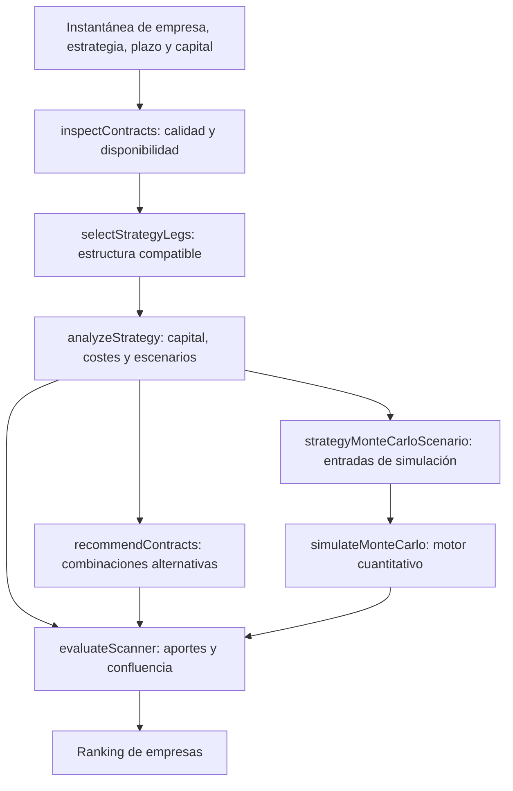

# Evaluación y ranking de estrategias

Esta carpeta reúne la coordinación del ranking y las estructuras de opciones.
No añade un octavo core funcional.

`ranking.ts` y `quantitative-criteria.ts` conservan la evaluación de demostración.
`observed-ranking.ts` utiliza evidencia observada. `strategy-analysis.ts` y
`strategy-eligibility.ts` seleccionan y evalúan piernas; `estimated-snapshot.ts`
identifica reconstrucciones bajo supuestos. `option-validation.ts` valida cadenas
históricas importadas y `gamma-path.ts` simula una trayectoria de coberturas.

`catalog.ts` describe los criterios antiguos del ranking y `evaluation-policy.ts`
sus parámetros. La lista de los siete cores funcionales está en `../catalog.ts`.

## Recorrido de la evaluación actual

Los 18 archivos TypeScript tienen comentarios en español antes de cada línea
de código. Los comentarios describen el comportamiento existente; documentar
los pesos no significa haberlos optimizado ni cambiado.



No hay envío de órdenes en este recorrido. El flujo de revisión, confirmación
y consulta del bróker pertenece a la mesa F5 y sus servicios.

## Mapa de los archivos

| Archivo | Responsabilidad | Función o elemento principal |
| --- | --- | --- |
| [scanner.ts](scanner.ts) | Integrar siete cores, cobertura, confluencia y escenario visual. | `evaluateScanner()` |
| [scanner-settings.ts](scanner-settings.ts) | Validar participación, pesos, regla, semilla y filtros. | `scannerSettingsSchema`, `activeScannerCores()` |
| [scan-universe.ts](scan-universe.ts) | Elegir universo de hasta 14 empresas y ordenar resultados. | `scanUniverse()`, `filterScanResults()` |
| [strategy-eligibility.ts](strategy-eligibility.ts) | Usar los mismos predicados para elegibilidad y descartes. | `inspectContracts()` |
| [strategy-analysis.ts](strategy-analysis.ts) | Seleccionar piernas y calcular posición, capital y riesgo modelado. | `selectStrategyLegs()`, `analyzeStrategy()` |
| [contract-recommendations.ts](contract-recommendations.ts) | Explorar combinaciones alternativas y ordenarlas. | `recommendContracts()` |
| [monte-carlo-scenario.ts](monte-carlo-scenario.ts) | Preparar la estructura para el motor Monte Carlo. | `strategyMonteCarloScenario()`, `buildScenario()` |
| [strategy-outlook.ts](strategy-outlook.ts) | Compartir pronóstico y valorar P/L condicional de comparables. | `strategyOutlook()`, `strategyPnlAtSpot()` |
| [estimated-snapshot.ts](estimated-snapshot.ts) | Reconstruir entradas faltantes como supuestos identificados. | `estimatedSnapshot()` |
| [evaluation-policy.ts](evaluation-policy.ts) | Validar límites temporales, pasos y ajustes cuantitativos. | `evaluationTuningSchema` |
| [observed-ranking.ts](observed-ranking.ts) | Conservar evidencia y delegar en el escáner cuando se configura. | `rankObservedCompanies()`, `observedOptionInputs()` |
| [ranking.ts](ranking.ts) | Mantener el ranking anterior de demostración. | `rankCompanies()` |
| [quantitative-criteria.ts](quantitative-criteria.ts) | Mantener heurísticas BSM, griegas y probabilidad de demostración. | `bsmCore`, `greeksCore`, `probabilityCore` |
| [catalog.ts](catalog.ts) | Describir los criterios cuantitativos anteriores. | `cores` |
| [option-validation.ts](option-validation.ts) | Probar el ranking cuantitativo anterior con salidas importadas. | `validateOptionRanking()` |
| [historical-exercise.ts](historical-exercise.ts) | Reconstruir el estado al corte y marcar un ejercicio teórico. | `historicalState()`, `historicalExercise()` |
| [gamma-path.ts](gamma-path.ts) | Reproducir coberturas delta sobre una trayectoria suministrada. | `simulateGammaPath()` |
| [income-opportunities.ts](income-opportunities.ts) | Filtrar CSP/CC y describir prima sobre garantía. | `incomeOpportunities()` |

## De dónde sale la lógica de comparación de los cores

Hay tres decisiones distintas que conviene explicar por separado:

1. **Validez de la estructura.** Las reglas de tipo de opción, proporción,
   vencimientos, unidades, capital y cotizaciones deciden si se puede analizar
   una operación. Están en `strategy-analysis.ts` y `strategy-eligibility.ts`.
2. **Transformación a puntuación.** `scanner.ts` convierte evidencia muy
   distinta a una escala común de compatibilidad 0–100. Las escalas y los
   umbrales están escritos explícitamente en el código.
3. **Participación relativa.** `scanner-settings.ts` define pesos iniciales de
   1 y la interfaz permite cambiarlos. No existe en este flujo un entrenamiento
   automático que haya aprendido esos pesos para los siete cores funcionales.

Por ello, una fórmula financiera y su puntuación son cosas distintas. BSM o
una simulación producen resultados bajo sus supuestos; convertirlos a una
preferencia de selección introduce decisiones de diseño. El código actual
es transparente sobre esas decisiones, pero no prueba que sean óptimas.

### Fórmulas de los siete aportes actuales

| Core | Cómo obtiene su puntuación | Relación con la estrategia |
| --- | --- | --- |
| Estrategia propia | Compra = 80, espera = 50, venta = 20. | Usa la regla técnica seleccionada; estos tres valores se mantienen entre estrategias. |
| Fundamental | Promedia componentes disponibles: margen, solvencia, ROE y razón corriente, normalizados a 0–100. | Los ratios y escalas son comunes; no se recalibran por cada estrategia. |
| Institucional | `50 + 50 × dirección`, usando flujo observado, SEC 13F o un proxy manual identificado según disponibilidad. | La dirección financiera se interpreta igual para las cuatro estrategias. |
| Noticias | `50 + 50 × sentimiento`; Gamma usa el valor absoluto del sentimiento. | Gamma favorece magnitud del tono en esa heurística, mientras las otras conservan el signo. |
| Indicadores técnicos | Promedia signo SMA20/50, signo MACD y componente RSI; lo transforma a 0–100. | Gamma usa magnitud de esa dirección, las demás conservan signo. |
| Estructura | Normaliza posición del cierre entre soporte y resistencia o extremos provisionales identificados. | La fórmula actual es común: el extremo inferior obtiene mayor aporte que el superior. |
| Monte Carlo | `100 × proporción de trayectorias con P/L positivo`. | Cambia con piernas, primas, signos, horizonte y entradas de la estructura seleccionada. |

Los rangos del aporte fundamental también son explícitos: margen entre −20%
y 20%, ROE entre −20% y 40%, razón corriente entre 0 y 2 y solvencia desde
pasivos/activos o la alternativa manual de deuda/patrimonio. Son escalas
heurísticas. Se conserva cobertura de hasta cuatro componentes y sus fuentes.

### Cómo se combinan y qué significa un faltante

```text
Confluencia = Σ(puntuación del core × peso) / Σ(pesos de cores evaluables)
```

Con técnico 80 de peso 2, fundamental 60 de peso 1 y noticias sin datos de
peso 1, la puntuación es `(80×2 + 60×1)/(2+1) = 73.33`. Noticias no aporta
un cero ni su peso al denominador. Si ningún core puede calcularse, el
resultado es `null` y la empresa se presenta como no evaluable.

Una consulta completa sin noticias recientes puede aportar neutral 50; una
consulta de noticias fallida sigue siendo ausencia. Un cero calculado es
distinto de ausencia y sí participa. Peso cero o core desactivado lo excluyen.

La confluencia es compatibilidad heurística. No equivale a PoP, rentabilidad
esperada ni confianza estadística. Además, empresas evaluadas con conjuntos
de datos diferentes pueden tener puntuaciones difíciles de comparar: hay que
leer la cobertura junto al número. Técnico y regla propia comparten indicadores,
por lo que dar peso alto a ambos puede repetir evidencia. La documentación
describe esa limitación; no añade una corrección que el algoritmo no implementa.

## Cómo se relacionan las estructuras con el cálculo

| Estrategia | Piernas y cantidades | Capital o aspecto especial del análisis |
| --- | --- | --- |
| Wheel | Una put vendida: `−1`. | Reserva nominal contractual más comisión; no evalúa todavía el ciclo futuro de acciones y call. |
| PMCC | Call larga `+1`, call corta `−1`, con larga ITM y vencimiento posterior. | Débito, financiación y reserva corta, salvo modo explícito solo débito. La LEAPS conserva tiempo al vencimiento corto. |
| Backspread | Call de strike inferior `−1` y dos calls de strike superior `+2`, mismo vencimiento. | Se calcula el valle de pérdida del payoff conjunto y sus equilibrios. |
| Gamma | Call `+1` y put `+1` del mismo strike y vencimiento. | Débito del straddle; la gestión con acciones necesita una trayectoria y costes adicionales. |

Cantidad positiva significa compra al ask; negativa significa venta al bid.
`equityTerms()` comprueba multiplicador y acciones entregables. El análisis
usa sus términos efectivos, sin presumir que cualquier contrato tenga 100
acciones. Las restricciones de capital que calcula este apartado no sustituyen
el margen y permisos que debe confirmar el bróker.

`analyzeStrategy()` calcula débito/crédito, medio spread agregado, griegas,
escenarios y capital. Para vencimiento común analiza payoff por segmentos,
raíces de equilibrio y masa de probabilidad lognormal donde el P/L es positivo.
Con diagonal PMCC no publica esa probabilidad analítica común ni extremos
globales de pérdida/ganancia. Una magnitud `null` no se convierte en riesgo cero.

## Recomendador: dónde está y cómo trabaja

El motor está en `contract-recommendations.ts`. La pantalla es
[`../../features/research/components/strategy-recommender.tsx`](../../features/research/components/strategy-recommender.tsx)
y delega el cálculo en
[`../../features/research/contract-recommendations.worker.ts`](../../features/research/contract-recommendations.worker.ts)
para mantener disponible la interfaz.

`recommendContracts()` recibe empresa, estrategia, días, ajustes, límite y orden:

1. Construye una estrategia inicial y explica los faltantes si no es posible.
2. Inspecciona contratos y prepara modo observado o estimado identificado.
3. Forma un conjunto de hasta 128 candidatos. Para PMCC reserva calls largas.
4. Repite el selector excluyendo contratos elegidos para descubrir alternativas,
   sin romper proporciones ni generar todo el producto cartesiano de la cadena.
5. Detiene trabajo a las 40 búsquedas o 24 combinaciones candidatas.
6. Evalúa cada estructura con el escáner y su perspectiva condicional.
7. Ordena por confluencia, retorno estimado disponible o menor capital, según
   la elección del usuario; desempata por spread e identidad de contratos.
8. Aplica confluencia mínima y devuelve de 1 a 10 propuestas; el valor inicial
   es cinco. Publica diagnósticos y avisa si la comparación quedó acotada.

La búsqueda es limitada y reproducible; no garantiza encontrar el mejor contrato
de toda la cadena. El orden por P/L depende de comparables y una valoración
condicional; una rentabilidad ausente no se inventa para completar el orden.

## Monte Carlo: preparación, simulación y uso en el escáner

`monte-carlo-scenario.ts` prepara las entradas. El motor numérico está en
[`../nucleo-cuantitativo/monte-carlo.ts`](../nucleo-cuantitativo/monte-carlo.ts),
función `simulateMonteCarlo()`. El panel independiente utiliza
[`../../features/research/monte-carlo.worker.ts`](../../features/research/monte-carlo.worker.ts).
El recomendador se ejecuta en su propio worker y el escáner llama al motor
para cada estructura dentro de ese cálculo.

`strategyMonteCarloScenario()` prefiere datos del proveedor en modo automático.
Si faltan primas o IV puede intentar reconstrucción identificada, siempre sobre
contratos existentes y con spot, tasa, dividendo y volatilidad utilizables.
No inventa tasas o dividendos cero. `buildScenario()` conserva cantidades,
entregables y primas; usa el primer vencimiento como horizonte y una sola sigma
del subyacente tomada de la primera pierna.

El motor genera rendimientos normales reproducibles mediante semilla y simula:

```text
Siguiente precio = precio × exp((r − q − σ²/2) × dt + σ × √dt × Z)
```

`r` es tasa, `q` rendimiento continuo de dividendos, `σ` volatilidad y `Z`
una realización normal. Es un GBM neutral al riesgo: no usa sentimiento ni
momentum como un pronóstico real de crecimiento del precio.

Cada trayectoria calcula el valor de la estructura y resta la entrada firmada
y costes definidos por el motor. La fracción con P/L positivo es PoP bajo ese
modelo. También entrega percentiles, medias, errores de muestreo, pérdidas
de cola y trayectorias para gráficos. Más trayectorias reducen error de muestreo,
no convierten sus supuestos en evidencia de mercado.

En `scanner.ts` se usa modo terminal con 16 pasos, semilla configurada y por
defecto 2000 trayectorias, sin coberturas dinámicas. En PMCC la LEAPS se marca
al vencimiento corto con plazo remanente e IV propia constante. La PoP del
straddle Gamma estático no acredita el rendimiento de Gamma Scalping.

`estimated-snapshot.ts` clona solo contratos que reconstruye, acota candidatos
y marca precios/griegas como `assumed`. Usa CRR para prima americana y BSM
para europea, con spread supuesto explícito. Los originales se conservan.

## Perspectiva, pronóstico y calidad para revisión

`strategy-outlook.ts` comparte pronósticos de 5, 20 o 60 sesiones para una misma
instantánea, eligiendo un horizonte que quepa antes del primer vencimiento.
Aplica retornos comparables del pronóstico y valora el P/L correspondiente con
comisiones de entrada/salida y entrada financiada. Publica media, P10, P90 y
retorno sobre capital cuando existen comparables.

Su estado `validated` refleja las comprobaciones del pronóstico de precio;
no demuestra por sí mismo rentabilidad histórica de las opciones. `executionReady`
comprueba calidad de entradas OPRA observadas y excluye demo/sandbox, pero
tampoco confirma permisos, margen, envío ni ejecución del bróker.

`strategyRecommendation()` devuelve esperar, explorar o prioridad de revisión
según escenario, confluencia y métricas. Sigue siendo una decisión heurística.

## Validaciones y ejercicios que no deben confundirse

| Archivo | Lo que evalúa | Lo que no acredita |
| --- | --- | --- |
| `option-validation.ts` | Ranking cuantitativo anterior con instantáneas OPRA y salidas importadas, separadas cronológicamente. | Escáner funcional completo, autenticidad de la fuente o fills reales. |
| `historical-exercise.ts` | Estado técnico causal y marca teórica de piernas fijadas al comienzo. | Que existieran esos contratos o primas de salida observadas. |
| `gamma-path.ts` | Rebalanceos con acciones enteras, bid/ask, comisiones y préstamo en la trayectoria suministrada. | Cotizaciones históricas de opciones si sus marcas se calculan por BSM. |
| `income-opportunities.ts` | Prima neta al bid sobre garantía de una CSP o CC recibida. | Rendimiento total esperado o un retorno anual reinvertible garantizado. |

En `option-validation.ts`, el entrenamiento solo utiliza salidas cuyo resultado
ya era conocido antes del primer corte de prueba. Compara candidatos de pesos
predefinidos con una referencia de pesos iguales. Marca muestra suficiente con
datos observados, 30 períodos de prueba, tres bloques y tres empresas distintas.
Wilson expresa incertidumbre de la frecuencia histórica y no demuestra que
los períodos financieros sean independientes.

Para estudiar o exponer, muestra primero `scanner.ts`, después
`strategy-analysis.ts`, `contract-recommendations.ts` y
`monte-carlo-scenario.ts`. Deja las validaciones para explicar qué resultados
se observaron, cuáles se simularon y qué evidencia todavía falta.
